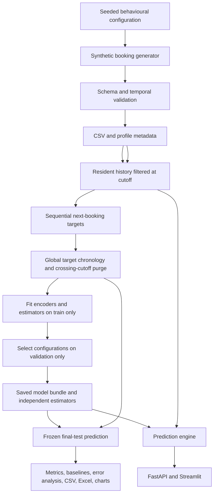

# Architecture

`config` centralizes defaults. `data_generator` creates only the five exported fields; personas are private simulation variables. `data_validation` fails before training on malformed input. `feature_engineering` filters each history with a searchsorted cutoff. `dataset_builder` pairs each unique resident creation cutoff with the next strictly later creation event. `temporal_split` establishes common partitions for every target.

`train` fits weighted facility and four regression estimators with training-only one-hot encoders, using validation for a fixed small grid. `predict` loads trusted Joblib models and applies temporal constraints; it has no training path. `evaluate` calculates raw matches and errors. `reporting` creates the five-sheet Excel workbook, charts and generated report. `workflow` composes independently runnable stages and rejects model/data hash mismatches.

The API loads models lazily into process memory; the dashboard caches by model/data modification time. Both call the same `PredictionEngine` and `FeatureBuilder`. There is no database, network dependency, GPU, scheduler, delivery service or external notification side effect. All input data is synthetic. Authentication and production access controls are outside this local prototype.

Resident history grows during chronological evaluation as each booking becomes available. Fitted weights, preprocessing and candidate choices stay fixed. This is sequential observation, with no fitting on validation/test outcomes.
