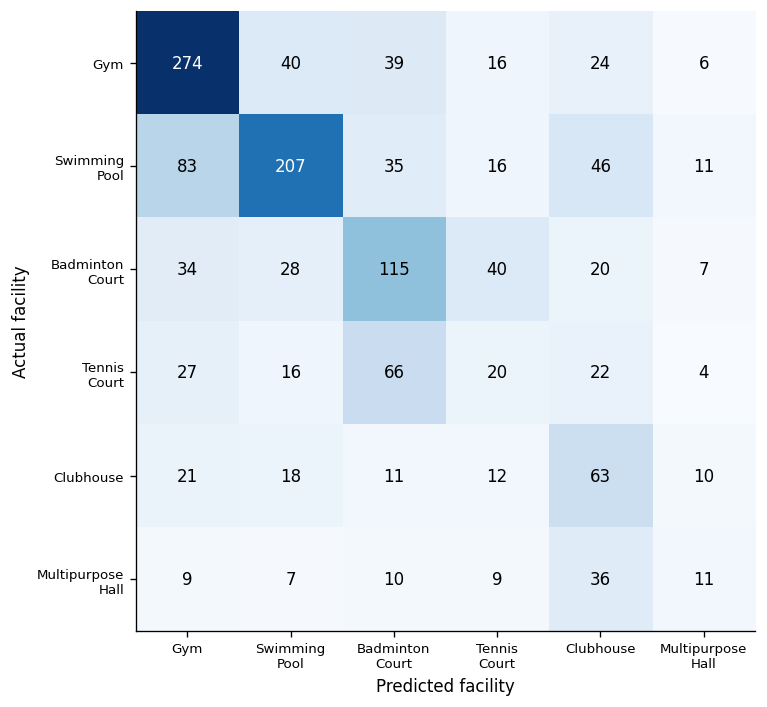
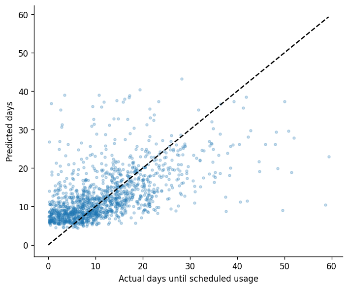
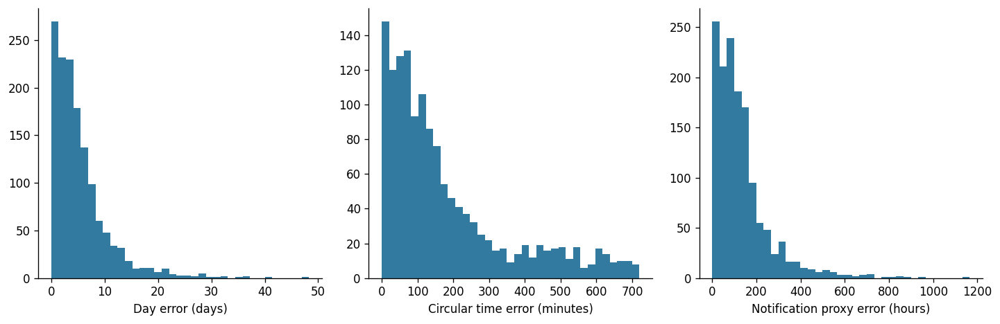

# Evaluation report

Generated from saved models and actual chronological holdout predictions; no metrics are hand-entered.

Test records: **1413**. Purged crossing-cutoff examples: **778**.

| Output / metric | ML | Resident baseline | Global baseline | ML improvement vs resident |
|---|---:|---:|---:|---:|
| Facility accuracy | 0.4883 | 0.5131 | 0.2824 | -0.0248 |
| Facility macro F1 | 0.3917 | 0.3777 | 0.0734 | +0.0141 |
| Days MAE | 5.3889 | 5.6682 | 7.2266 | +0.2793 |
| Circular time MAE (minutes) | 181.1062 | 196.4013 | 266.4650 | +15.2951 |
| Notification proxy MAE (hours) | 131.8147 | 134.3071 | 182.8297 | +2.4924 |

Exact 4/4 match: **0.00%**. Tolerance 4/4 match: **0.50%**.
Average exact matches: **0.703/4**. Average tolerance matches: **0.985/4**.

Exact means facility, calendar date, clock-hour bucket, and full notification timestamp equality. Tolerance means facility exact, date within one calendar day, time within 60 circular minutes, notification within 3 elapsed hours. No underlying predictions are rounded for equality.

Day-regression metrics use raw predicted elapsed days; calendar-date metrics use the assembled usage date. Notification errors include errors propagated from predicted usage and the constrained lead model. They measure a historical booking-time proxy only.

## Chronological boundaries

```json
{
  "strategy": "70/15/15 target creation chronology; purge validation/test cutoffs before model-ready boundaries",
  "validation_start": "2026-02-05 15:01:28+05:30",
  "test_start": "2026-04-16 20:17:23+05:30",
  "counts": {
    "train": 8400,
    "validation": 1409,
    "test": 1413
  },
  "purged_examples": 778,
  "ranges": {
    "train": {
      "target_start": "2025-01-04 11:55:55+05:30",
      "target_end": "2026-02-05 14:16:14+05:30",
      "earliest_cutoff": "2025-01-02 02:34:51+05:30"
    },
    "validation": {
      "target_start": "2026-02-06 10:28:14+05:30",
      "target_end": "2026-04-16 20:05:03+05:30",
      "earliest_cutoff": "2026-02-05 15:01:28+05:30"
    },
    "test": {
      "target_start": "2026-04-18 07:08:42+05:30",
      "target_end": "2026-06-30 12:03:56+05:30",
      "earliest_cutoff": "2026-04-16 20:17:23+05:30"
    }
  }
}
```

## Error analysis

The following groups are diagnostic slices, not causal explanations. Preference shift is a history-only proxy (L1 distance > 0.12 between recent and lifetime smoothed facility shares), not access to synthetic persona labels.

| Activity group | Samples | Facility accuracy | Date MAE (days) | Time MAE (minutes) | Notification MAE (hours) |
|---|---:|---:|---:|---:|---:|
| Frequent (20+) | 1213 | 49.22% | 4.78 | 176.61 | 115.83 |
| Moderate (5-19) | 190 | 47.89% | 9.32 | 204.01 | 229.10 |
| Sparse (0-4) | 10 | 20.00% | 8.84 | 291.74 | 222.26 |

Lowest facility recall occurs for **Tennis Court** (12.90%, n=155). Class imbalance, exploration, multimodal usage hours, and changing preferences make rare-facility and timing predictions difficult.
Notification errors can remain large even when facility prediction is correct: an error of one day in scheduled usage can move the implied booking-time proxy by roughly 24 hours. Exact notification equality is intentionally strict and is generally unlikely for a continuous regression output.

Full metrics, all three model variants, subgroup counts, seasonal-transition and drift-proxy slices, and error quantiles are in `outputs/evaluation_report.json`. Every final test row is in the workbook and CSV.




