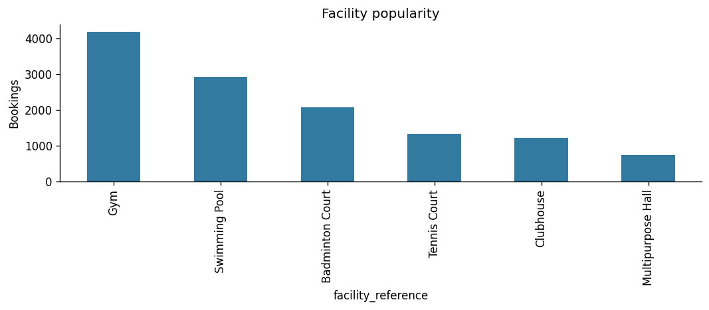
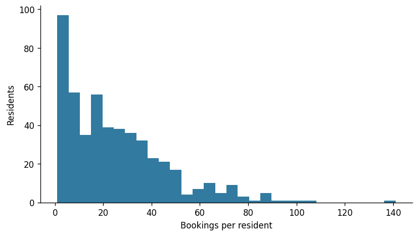
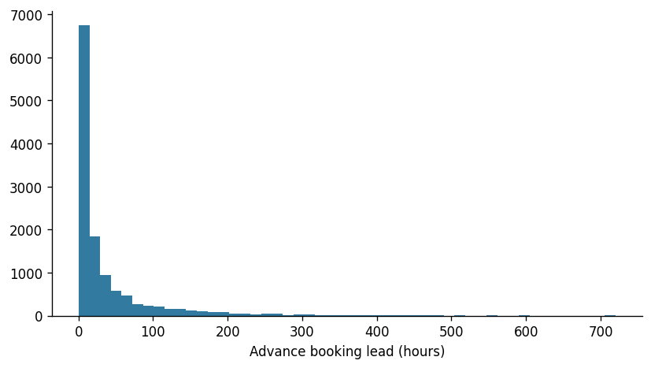
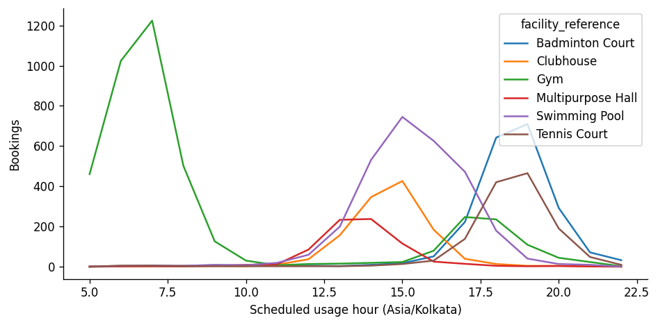
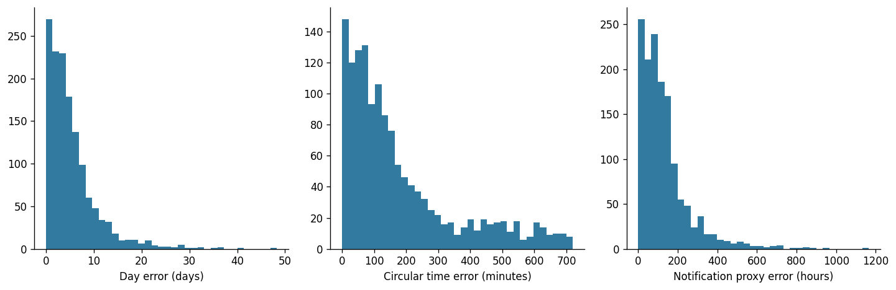
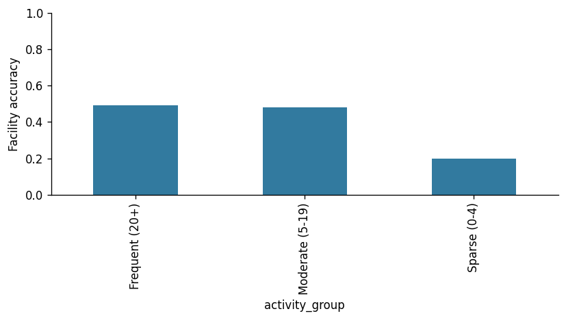

# Facility Usage Prediction — Technical Documentation

## Executive summary and business understanding

Residential communities offer gyms, pools, sports courts and social spaces. Habit-aware predictions can help residents discover relevant facilities and help community teams plan engagement. This prototype learns the next **observed booking**, its scheduled usage date/time, and a historical booking-time proxy for a reminder. It is not a booking-probability, attendance, capacity, or causal notification-effectiveness model.

Deliverables are an executable modular Python repository; synthetic bookings; persisted models; rigorous chronological metrics and baselines; a formatted five-sheet Excel review; diagnostic charts; tests; and optional local dashboard/API. [The evaluation report](evaluation_report.md) contains actual generated results, including weak performance and baseline wins.

## Data understanding and synthetic generation

The dataset contains 500 residents, six facility classes, 12,500 bookings and 18 calendar months. Asia/Kolkata is used consistently for all feature, date and clock calculations. The five-field schema is documented in [the data dictionary](data_dictionary.md).

The generator allocates unequal activity using gamma-distributed resident rates, sparse residents, and multinomial event counts. Some residents arrive late or stop early. Fitness, swimming, sports, social, occasional and mixed latent personas weight facility preferences; facility popularity weights create imbalance. Most residents have a noisy recurring schedule, others irregular event dates. Facility and personal effects influence advance-booking leads and usage hours. Weekend swimming/social sessions, early gym use, evening sports, summer pool demand and beginning-of-year gym demand are explicit effects. A configurable subset changes preferences partway through the observation window, and exploration creates occasional atypical bookings. These latent variables never enter the exported dataset or the feature matrix.

This is a controlled behavioural simulation, not calibrated to an actual housing community. Events are generated from a scheduled-usage process and then sorted by creation time. Advance bookings can reorder usage chronology, which is why **booking creation**, not usage order, defines next-event targets. Duplicate creation timestamps are handled as simultaneous observations.

Input validation rejects duplicate IDs, missing values, unknown facilities, malformed/out-of-range residents, wrong timezone types, invalid lead times, and out-of-order creation events. Generator configurations additionally check exact population and record counts. Profiling reports facility imbalance, activity quantiles, sparsity, timestamp ranges and lead-time quantiles. See [dataset profile](dataset_profile.md).

## Exploratory data analysis

The generated dataset has unequal facility popularity and long-tailed activity/lead times. These effects justify macro F1, per-class recall and subgroup reporting alongside accuracy. Multimodal usage hours challenge continuous time-of-day predictions even with circular encoding. Sparse and changing histories limit personalization. Exact counts and distribution statistics are generated in `data/dataset_metadata.json`, rather than manually maintained here.

## Prediction examples and leakage prevention

For each resident, sort by booking creation timestamp. Each distinct creation event, except the last, supplies a prediction cutoff. All records at or before the cutoff are visible; the first strictly later creation is the target. Tied future creations use a stable first-row convention. The first observed booking is not a supervised target because it lacks a previous-booking cutoff; truly unseen histories are served by fallback at inference.

`FeatureBuilder` is the single shared implementation for training, dashboard and API. It filters each resident history before every aggregate. A scheduled usage time or booking lead for an **already created** booking is observable, even if that scheduled usage is still in the future. Actual attendance and outcomes are not assumed observable. Resident IDs and latent personas are not model inputs. There are no full-dataset resident aggregates merged into historical rows.

The global target-creation timeline defines 70/15/15 boundaries with timestamp ties kept together. We additionally purge validation/test examples whose prediction cutoff precedes their respective boundary, so a sparse resident is never backtested with a model selected using later outcomes. Models fit only training samples; encoders fit only training feature categories. Validation chooses candidates; no train+validation refit is performed. Sine/cosine pairs are chosen jointly by circular validation MAE. No random early-stopping holdout is used. Historical records encountered during validation/test can update features as they become observable; weights never update. API inference rejects cutoffs before the model selection boundary.

Scheduled future usage and lead targets become known when the target booking is created, so they do not require an attendance-outcome embargo. This assumption would change for attended usage/no-show prediction. [Saved split metadata](../outputs/split_boundaries.json) records all exact boundaries, retained ranges and purged counts.

Tests append and modify future records and verify invariant historical features. A stronger isolation test poisons the entire final-test feature/outcome partition, refits, and verifies identical candidates, selections and predictions. Encoder category tests verify train-only fitting. No normalization or learned imputation sees validation/test data.

## Feature engineering

[Feature documentation](feature_documentation.md) defines each family and defaults. Features include cumulative/rolling activity, interval summaries and regularity; lead summaries; facility counts and Laplace-smoothed shares; exponentially weighted recent preferences; known previous usage context; cutoff weekday/hour/month/season/weekend; preferred weekday/hour; circular usage means and facility-specific circular summaries. Sparse categories are regularized by +1 pseudo-counts. Missing intervals have fixed, explicitly documented defaults; these are not inferred from future events.

Since cutoffs are event-driven, days since last booking is normally zero during training. It becomes informative for later inference cutoffs but this extrapolation is limited. No amount of feature complexity identifies future resident intention from random exploration.

## Modelling strategy and alternatives

The implementation uses CPU-compatible scikit-learn HistGradientBoosting with persisted one-hot categorical preprocessing. A predeclared two-configuration grid changes leaf count, iteration count and L2 regularization. Seeds are fixed; early stopping is disabled to avoid internal random chronological contamination. Categorical vocabularies are learned exclusively on training rows, with unseen values ignored safely.

1. **Facility:** weighted multiclass classifier. Square-root inverse-frequency training weights address class imbalance without fully equalizing very rare classes. Select by validation macro F1; also report accuracy, weighted F1, per-class precision/recall/support and confusion matrix.
2. **Usage day:** absolute-error regressor for elapsed days from cutoff to target scheduled usage. Predictions are constrained to 0–365 days. The implied elapsed timestamp supplies a calendar date; predicted circular time supplies its clock time, rolling forward when necessary to keep usage after cutoff. Raw elapsed-day MAE is reported separately from assembled calendar-date error.
3. **Usage time:** two squared-error regressors for sine/cosine of local minutes after midnight. Reconstruct with atan2 into [0, 1440). Select the pair by validation shortest-arc MAE. Resultant magnitudes below 0.05 use historical preferred-time fallback. No rounding is applied to evaluation timestamps.
4. **Notification proxy:** absolute-error regressor for booking lead hours, using history-only features. This component intentionally does not consume actual or predicted downstream context, keeping its independent evaluation simple and avoiding training/inference stacking mismatch. Clamp leads to 0.25–720 hours, subtract from predicted usage, and constrain the notification to after cutoff and at least 15 minutes before usage. Report both standalone lead errors and final proxy timestamp errors, including propagated usage errors.

Unseen/one-history residents use train-only global timing medians and available resident facility history. The main classifier's internal scores are not calibrated probabilities and are not presented as confidence claims.

Logistic regression would be an interpretable facility baseline but needs interaction design. Random forests handle nonlinearities but are typically larger. CatBoost is a strong alternative with native categorical handling; we consulted its documentation but selected scikit-learn for a compact dependency footprint and consistent CPU pipelines. A first-order Markov model could capture last-facility transitions; collaborative filtering could capture shared tastes but does not directly solve elapsed day, circular time and lead prediction and needs strict global chronology. LSTMs and other sequence networks add tuning/data demands at this dataset size without a demonstrated benefit. These alternatives were considered, not implemented or benchmarked.

## Evaluation methodology

Global-mode facility, median elapsed days, mode usage minute, and median lead form the train-only global baseline. The resident baseline uses cutoff-limited most frequent facility, median booking interval plus median historical lead, preferred hour, and median lead, with train-only global fallback for insufficient history. All predictions use identical ordering and timestamp constraints.

- Facility: accuracy, macro/weighted F1, per-class precision/recall/support, confusion matrix.
- Day: raw elapsed-days MAE/median AE, reconstructed weekday accuracy, elapsed-day thresholds of one/two/three days, plus calendar-date MAE.
- Time: shortest circular minute MAE/median AE and fractions within 30/60/120 minutes. Midnight wraparound is tested explicitly.
- Notification: final reconstructed timestamp MAE/median AE in hours, thresholds of one/three/six hours; standalone predicted lead errors are also recorded.

Every final record has separate exact and tolerance indicators. Exact means facility equality, calendar-date equality, clock-hour equality and full notification timestamp equality, **without rounding predictions**. Tolerance means facility equality, date within one calendar day, shortest circular time within 60 minutes and notification within three hours. We report exact and tolerance 4/4 rates and averages out of four. A threshold error rate and average MAE can move in different directions; both are shown.

Error analysis includes rare facilities, incorrect predictions, sparse/frequent histories, calendar-quarter transitions, and a history-only preference-shift proxy based on recent versus lifetime smoothed facility shares. These are descriptive associations, not causal explanations or access to hidden drift labels. The workbook includes representative failures with rule-based descriptive annotations.

## Results and business interpretation

See [generated evaluation report](evaluation_report.md) and [complete JSON metrics](../outputs/evaluation_metrics.json) for current results. ML improves macro F1 and average timing errors over the resident baseline, but the resident facility mode has higher accuracy and the resident baseline has a higher strict-tolerance 4/4 rate. The approach is not uniformly better than heuristics. Day uncertainty propagates into notification timestamps, so notification proxy errors remain large. Exact timestamp matches are unsurprisingly rare for a continuous regressor. These findings argue for broad engagement windows and a validated reminder policy rather than exact-time promises.

## Architecture and reproducibility

[Architecture](architecture.md) describes the modules and artifact flow. Dataset hash, seed, exact chronology, training/selection row indices, feature names, selected settings, candidate validation scores, Python and dependency versions are saved with the bundle and in JSON. Independent estimator artifacts support replacement; the bundle is the inference entry point. Prediction/evaluation scripts never retrain. An environment lock records transitive versions. Cache entries include source and dataset fingerprints and are excluded from submission. The README provides exact stage-by-stage and complete-run commands.

## Limitations and future improvements

See [limitations](limitations.md) for the full scope. Synthetic patterns do not establish real-world generalization; capacity, cancellations, no-shows, notification engagement and booking probability are absent. Before deployment, integrate real event streams with privacy controls, validate timestamp semantics and availability, track notification delivery/engagement/conversion, estimate probability of any booking, monitor drift, retrain on a documented cadence and use controlled experiments to assess notification effectiveness. Predictive association is insufficient for optimizing a causal action.

## References and decisions informed

- [Scikit-learn: Common pitfalls and recommended practices](https://scikit-learn.org/stable/common_pitfalls.html) — train-only preprocessing, shared inference transformations and test isolation.
- [Scikit-learn: Cross-validation on time series](https://scikit-learn.org/stable/modules/cross_validation.html#time-series-split) — chronological evaluation; irregular resident events motivate custom timestamp boundaries rather than blindly applying equal-spaced TimeSeriesSplit.
- [Scikit-learn: Histogram gradient boosting](https://scikit-learn.org/stable/modules/ensemble.html#histogram-based-gradient-boosting) — lightweight nonlinear tabular models and relevant loss functions.
- [Scikit-learn: Classification metrics](https://scikit-learn.org/stable/modules/model_evaluation.html#classification-metrics) — macro/weighted F1 and per-class evaluation under imbalance.
- [CatBoost categorical features documentation](https://catboost.ai/docs/en/features/categorical-features) — native categorical modelling alternative; CatBoost is not required or used in the submitted pipeline.
- [Ji et al., A Critical Study on Data Leakage in Recommender System Offline Evaluation](https://arxiv.org/abs/2010.11060) — respecting the global timeline instead of per-user leave-last-one-out splits that can learn from other users' later events.
- [Camargo et al., Discovering Generative Models from Event Logs: Data-driven Simulation vs Deep Learning](https://arxiv.org/abs/2009.03567) — event-log simulation as a configurable behavioural abstraction, with explicit realism limits rather than independent random columns. Our simulator is hand-specified, not discovered from real logs. No implementation is copied.

References were consulted during development. Research motivates methodological choices; no paper's empirical result is claimed for this community dataset.
